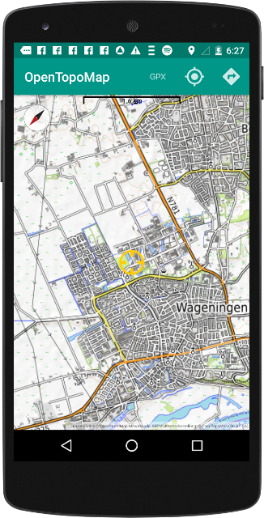
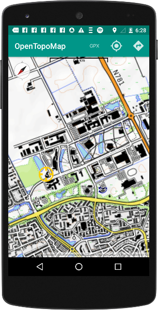
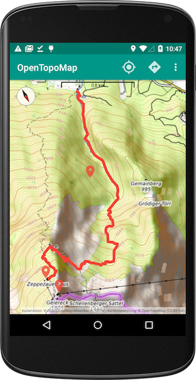
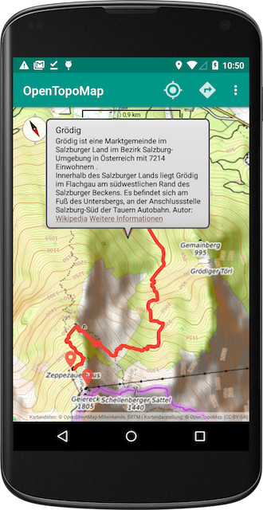
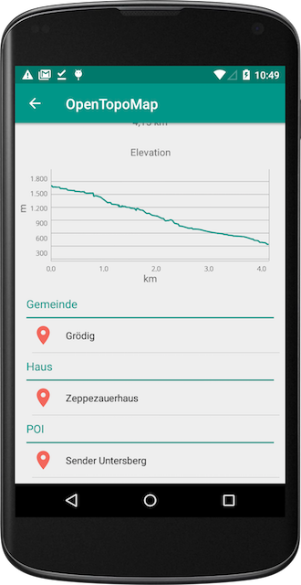

# OpenTopoMapViewer

An Android map viewer for topographic maps, tracks, places and lightweight route planning.

[](https://github.com/Pygmalion69/OpenTopoMapViewer/releases)

## Features

### Maps and location

- Multiple raster base maps: OpenTopoMap, OpenTopoMap-R, Top-O-Map, OpenStreetMap, OpenHikingMap and Freemap.sk
- Waymarked Trails overlays for hiking and cycling routes
- Follow the device location and quickly return to it
- Location details with coordinates and GPS/NMEA elevation; optional ORS elevation lookup
- Optional map rotation using the compass or GPS bearing
- Fullscreen-on-tap, keep-screen-on and maximum zoom settings

### GPX and KML

- Open GPX files and display tracks, routes and waypoints
- Zoom to imported tracks and inspect distance, elevation profile, track description and waypoint details
- Choose the GPX track color
- Optional KML/KMZ import, display and zoom-to-content support
- Remove imported GPX or KML content directly from the map

### Markers and nearby places

- Add persistent markers by long-pressing the map, then edit, drag or delete them
- Set marker names, descriptions and individual colors
- Optional marker labels with a configurable minimum zoom level
- Import and export markers as GPX waypoints, including bulk selection and deletion
- Browse nearby Wikipedia places and place a selected result on the map

### OpenRouteService integration

When an [OpenRouteService](https://openrouteservice.org/) API key is configured:

- Search for places with debounced autocomplete and add a selected result as a normal editable marker
- Calculate routes using markers as waypoints
- Recalculate routes after waypoints are added, removed or dragged
- Choose profiles for car, truck, several bicycle types, walking, hiking and wheelchair routing
- Display calculated routes as GPX, including route details and elevation data

### Offline use and customization

- Import an OpenTopoMap tile ZIP into the offline cache
- Configure the tile-cache location and maximum cache size
- Light and dark theme support
- English, German, Spanish, French, Italian and Dutch interface translations

See [Importing offline map tiles](#importing-offline-map-tiles) below for the required archive layout and import workflow.

Routing, elevation and place search use the [ORS Android Client](https://github.com/Pygmalion69/ors-android-client). See [How to Enable Basic Routing with OpenRouteService (ORS) in OpenTopoMap Viewer](https://pygmalion.nitri.org/how-to-enable-basic-routing-with-openrouteservice-ors-in-opentopomap-viewer-1818.html) for setup instructions.

 

 



## Importing offline map tiles

Ready-made packages for regions in **Europe** are available in the [offline map catalogue](https://opentopomap.nitri.org/offline/). If your region is missing, [request an offline map package](https://github.com/Pygmalion69/OpenTopoMapViewer/issues/new?template=offline_map_request.md).

Use **Settings → Cache → Import offline tiles** to import an OpenTopoMap tile ZIP through Android's file picker. There is no need to copy files into Android's protected app directories or extract the ZIP on the device.

### Prepare the ZIP

The importer accepts PNG raster tiles in either of these layouts, starting at the ZIP root:

```text
OpenTopoMap/{z}/{x}/{y}.png
{z}/{x}/{y}.png
```

Here, `z` is the numeric zoom level (0–17), and `x` and `y` are the original numeric tile coordinates. For example, a tile can be stored as `OpenTopoMap/17/67500/44000.png` or `17/67500/44000.png`. Each zoom level needs its own numeric directory. Do not add an enclosing atlas or region folder.

**MOBAC:** choose the **Osmdroid ZIP** format, then inspect the paths inside the resulting archive. MOBAC may produce a descriptive directory such as:

```text
Monde, OpenTopoMap XML cartes de randonnées-Z(17)/{x}/{y}.png
```

That layout cannot be imported as-is. Extract the archive on your computer, create `OpenTopoMap/17/`, and move the existing `x` directories into it. Repeat for every zoom level: for example, move the contents of a directory ending in `-Z(14)` into `OpenTopoMap/14/`. Leave the actual `x` directory names and `y.png` filenames unchanged.

Create a new ZIP containing the `OpenTopoMap` directory directly at its root. Merely renaming the descriptive directory to `OpenTopoMap` is **not sufficient**: that would still omit the numeric zoom-level directory.

### Import and display the tiles

1. Copy the prepared ZIP to a location available through Android's file picker, such as **Downloads**.
2. If necessary, configure **Settings → Cache → Cache settings** first, including a cache size large enough for the imported tiles and normal map use.
3. Open **Settings → Cache → Import offline tiles** and select the ZIP itself.
4. Wait for **Imported … tiles.** If the app reports **No tiles imported. Check ZIP format.**, check the paths inside the archive against the layouts above. A successful import count does not guarantee that every file in the ZIP was accepted.
5. In **Settings → Screen → OpenTopoMap tile source**, select **OpenTopoMap (Archive/Preloaded)**. On the map, select **OpenTopoMap** as the base map in **Layers**. Imported tiles are stored under this source; selecting OpenTopoMap-R, Top-O-Map or another base map will not display them.
6. Pan to the imported area and select a zoom level included in the ZIP. If you imported levels 16 or 17, raise **Settings → Screen → Maximum zoom level** accordingly; the default is 15. The import does not automatically move the map to the imported area.
7. Before relying on the map outdoors, test the required area and zoom levels in airplane mode. Only the tiles actually included in the ZIP are available offline; importing a GPX file does not download its surrounding map.

### Updating and keeping imported tiles

- Importing the same tile again replaces the existing tile for that source, zoom level and coordinates.
- Imported tiles are stored in the shared map cache and given a non-expiring timestamp. They can be displayed while online as well as offline; connecting to the internet does not automatically replace them with newer online tiles. Import a newer ZIP to update them.
- Keep the original ZIP so you can import it again if the cache is removed. Imported tiles are cache contents, not a separate permanent offline map layer.
- **Clear map cache** also deletes imported tiles. Applying **Cache settings** clears the SQLite cache too, so configure those settings before importing. Do not rename the tile-cache directory to switch between online and offline maps.
- There is currently no independent switch to temporarily hide imported tiles while using the same OpenTopoMap source.

## Forks and third-party distributions

OpenTopoMap Viewer is open-source software licensed under the Apache License 2.0. The licence permits modification and redistribution, including under a different name.

Please note, however, that third-party forks and rebranded distributions are independent projects. They may contain older versions of OpenTopoMap Viewer, additional modifications, different advertising or analytics components, or different release and signing practices.

This repository is the upstream development project for OpenTopoMap Viewer. Issues, releases and security fixes published here apply to the official OpenTopoMap Viewer builds only.

If you maintain a fork and fix a bug or make a generally useful improvement, contributions back to the upstream project are very welcome.

&nbsp;

<a href="https://play.google.com/store/apps/details?id=org.nitri.opentopo" target="_blank" rel="noopener"></a>

(Has ads.)

&nbsp;

<a href="https://f-droid.org/packages/org.nitri.opentopo">
    </a>

(FOSS, no ads.)
